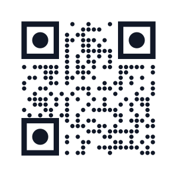

# Laravel QR Code Generator

[](https://packagist.org/packages/linkxtr/laravel-qrcode)
[](https://packagist.org/packages/linkxtr/laravel-qrcode)
[](https://packagist.org/packages/linkxtr/laravel-qrcode)
[](https://packagist.org/packages/linkxtr/laravel-qrcode)
[](https://github.com/Linkxtr/laravel-qrcode/actions/workflows/tests.yml)
[](https://github.com/Linkxtr/laravel-qrcode)
[](https://github.com/Linkxtr/laravel-qrcode)
[](https://github.com/Linkxtr/laravel-qrcode)
[](https://packagist.org/packages/linkxtr/laravel-qrcode)

**`linkxtr/laravel-qrcode`** is the actively maintained, modern QR code generator engineered specifically for **Laravel 12 & 13** (and PHP 8.2–8.5). Built on the vector-native `bacon/bacon-qr-code` v3 engine, it pairs clean Laravel ergonomics with uncompromising engineering rigor—backed by an automated test suite that decodes and validates every generated QR code to prove real-world scannability.

**[📚 Read the Full Documentation](https://laravel-qrcode.mintlify.app)**

---

## 🎨 Visual Showcase Gallery

Every QR code below is an actual SVG generated directly by `linkxtr/laravel-qrcode` and verified with automated barcode decoding.

| Style | Scannable Preview | 3-Line Fluent Snippet |
| :--- | :---: | :--- |
| **1. Classic Brand Color**<br>Crisp brand foreground |  | <pre><code>QrCode::size(300)<br>    -&gt;color(30, 64, 175)<br>    -&gt;generate(&#39;https://linkxtr.com&#39;);</code></pre> |
| **2. Dot Modules + Circle Eyes**<br>Modern rounded aesthetic |  | <pre><code>QrCode::size(300)<br>    -&gt;style(&#39;dot&#39;)-&gt;eye(&#39;circle&#39;)<br>    -&gt;color(17, 24, 39)<br>    -&gt;generate(&#39;https://linkxtr.com&#39;);</code></pre> |
| **3. Diagonal Gradient**<br>Vibrant two-tone transition |  | <pre><code>QrCode::size(300)<br>    -&gt;gradient([99, 102, 241], [236, 72, 153], &#39;diagonal&#39;)<br>    -&gt;eye(&#39;circle&#39;)<br>    -&gt;generate(&#39;https://linkxtr.com&#39;);</code></pre> |
| **4. Multi-Color Custom Eyes**<br>Distinct corner branding |  | <pre><code>QrCode::size(300)<br>    -&gt;color(31, 41, 55)<br>    -&gt;eyeColor(0, [239, 68, 68], [153, 27, 27])<br>    -&gt;eyeColor(1, [16, 185, 129], [6, 95, 70])<br>    -&gt;generate(&#39;https://linkxtr.com&#39;);</code></pre> |
| **5. Center Logo Merge**<br>Embedded logo with high EC |  | <pre><code>QrCode::size(300)<br>    -&gt;errorCorrection(&#39;H&#39;)<br>    -&gt;merge(public_path(&#39;vendor/linkxtr/logo.png&#39;), 0.25)<br>    -&gt;generate(&#39;https://linkxtr.com&#39;);</code></pre> |

---

## ⚖️ Why `linkxtr/laravel-qrcode`?

| Feature | `linkxtr/laravel-qrcode` | `simplesoftwareio/simple-qrcode` | Raw `endroid/qr-code` |
| :--- | :---: | :---: | :---: |
| **Active Maintenance** | ✅ **Actively Maintained** (v3.4.0) | ❌ Abandoned (Last: Feb 2021) | ✅ Active generic library |
| **Laravel Compatibility** | ✅ **Laravel 12 & 13** | ❌ Laravel &le; 8 only | ⚠️ Requires manual wiring |
| **PHP Support** | ✅ **PHP 8.2 – 8.5** | ❌ PHP &le; 8.0 | ✅ PHP 8.1+ |
| **Underlying Engine** | `bacon/bacon-qr-code` v3 | `bacon/bacon-qr-code` v1/v2 | Custom rasterizer / Bacon |
| **Immutable Fluent Builder** | ✅ Cloned instances (no leak) | ❌ Mutable state leakage | ⚠️ Partial builder pattern |
| **Laravel Facade** | ✅ `QrCode::...` (Drop-in familiar) | ✅ Legacy facade | ❌ None |
| **Native Blade Component** | ✅ `<x-qr-code />` with accessible SVG | ❌ None | ❌ None |
| **Artisan CLI Generator** | ✅ `php artisan qr:generate` | ❌ None | ❌ None |
| **Laravel Cache Integration** | ✅ Built-in (`cache()`, TTL, stores) | ❌ None | ❌ None |
| **Rich Data Types** | ✅ 12 built-in payloads | ⚠️ 5 basic payloads | ❌ None built-in |
| **Automated Scannability** | ✅ Every QR code decoded in CI | ❌ None | ❌ None |
| **Quality & Coverage** | ✅ **100% Coverage & PHPStan Max** | ❌ Untyped legacy codebase | ⚠️ Variable |

> **Drop-in Familiarity:** `linkxtr/laravel-qrcode` is built on `bacon/bacon-qr-code` with full Laravel idioms and drop-in familiarity for `simple-qrcode` users. Transitioning requires zero mental overhead while gaining full immutability, type safety, and first-class Laravel 12 & 13 support.

---

## ⚡ Quickstart

Install the package via Composer:

```bash
composer require linkxtr/laravel-qrcode
```

Optionally publish the configuration file:

```bash
php artisan vendor:publish --tag=qrcode-config
```

---

## 🛠️ Usage

### 1. The Fluent Facade

```php
use Linkxtr\QrCode\Facades\QrCode;

$qr = QrCode::size(400)
    ->format('svg')
    ->color(30, 64, 175)
    ->errorCorrection('H')
    ->merge(public_path('logo.png'), 0.25)
    ->generate('https://example.com');
```

### 2. The Blade Component

Drop accessible QR codes directly into Blade views with zero PHP logic:

```blade
<x-qr-code
    data="https://example.com"
    size="300"
    color="#1E40AF"
    margin="2"
/>
```

The component automatically renders compliant SVG markup, inherits default settings from `config/qrcode.php`, and applies accessibility attributes (`role="img"`, `aria-label`).

### 3. Interactive Artisan CLI

Generate QR codes straight from your terminal with interactive prompts:

```bash
php artisan qr:generate
```

Or pass flags directly:

```bash
php artisan qr:generate --data="https://example.com" --output="public/qr.svg" --format=svg --size=400
```

### 4. High-Performance Caching

Cache expensive QR code rendering seamlessly using Laravel's cache manager:

```php
// Cache for the configured default TTL
QrCode::size(400)->cache()->generate('https://example.com');

// Cache for a custom TTL (in seconds) or DateInterval
QrCode::size(400)->cache(3600)->generate('https://example.com');
```

### 5. Rich Data Types

Built-in helpers format payloads according to international standards:

```php
// Wi-Fi network configuration
QrCode::WiFi([
    'ssid' => 'OfficeNetwork',
    'encryption' => 'WPA2',
    'password' => 'secret-key',
]);

// Contact card (vCard / MeCard)
QrCode::VCard(
    name: 'Omar Fathy',
    phone: '+1234567890',
    email: 'omar@example.com',
    company: 'ApricotCake',
);

// Cryptocurrency payment
QrCode::BTC('bc1qxy2kgdygjrsqtzq2n0yrf2493p83kkfjhx0wlh', 0.005);
QrCode::Ethereum('0x71C7656EC7ab88b098defB751B7401B5f6d8976F', 0.5);

// Direct messaging & communication
QrCode::Email('hello@example.com', 'Say Hi!');
QrCode::Telegram('username');
QrCode::WhatsApp('1234567890', 'Hello from Laravel!');
QrCode::SMS('1234567890', 'Verification Code');
```

---

## 📖 Documentation

For full installation guides, advanced customization (radial/diagonal gradients, CMYK color spaces, custom eye shapes), and macro registration, visit the official documentation:

👉 **[laravel-qrcode.mintlify.app](https://laravel-qrcode.mintlify.app)**

---

## 🚀 Upgrading to V3

If you are upgrading from `simplesoftwareio/simple-qrcode` or `linkxtr/laravel-qrcode` v1.x/v2.x, please refer to our **[Upgrade Guide](https://laravel-qrcode.mintlify.app/advanced/upgrade-guide)** for breaking changes and migration steps.

---

## 📄 License

The MIT License (MIT). Please see [License File](LICENSE) for more information.
